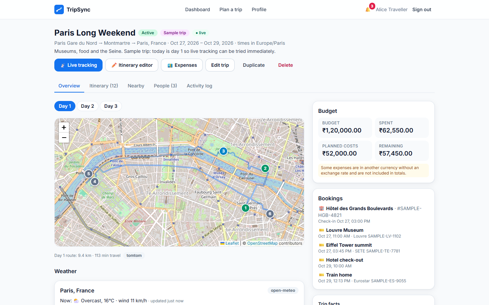
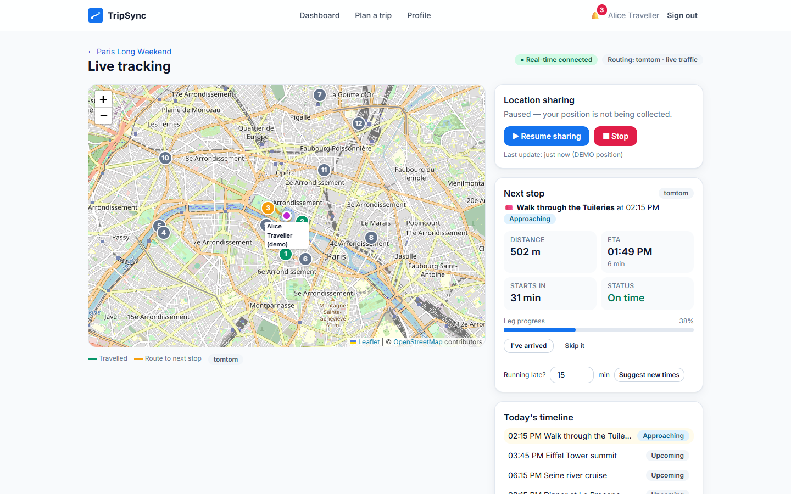
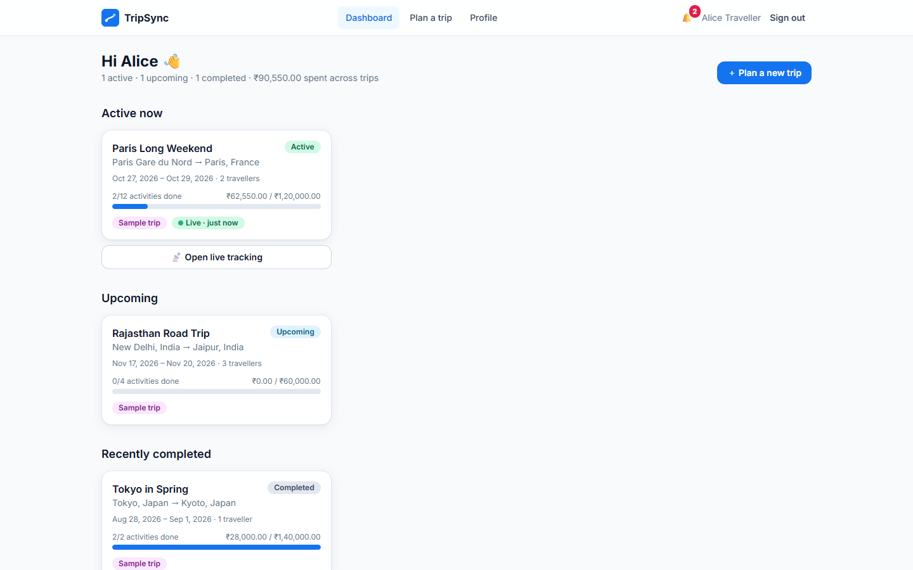

# TripSync — Real-Time Smart Trip Planner

TripSync is a full-stack trip planner and live travel companion. You plan day-by-day itineraries, share your journey live with the people you choose, and the itinerary adapts as the trip happens: arrival detection, live-traffic ETAs, reschedule proposals you approve, weather flags and notifications, all backed by MongoDB and pushed over Socket.IO.

**Live app:** https://advancedtripplanner.onrender.com (free hosting: the first visit after a quiet period takes about a minute to wake up)
**Google drive link**: https://drive.google.com/drive/folders/1ATBc6EVU32IBtlAQOY466WtO8A2cIHrl

**Stack:** MongoDB + Mongoose · Node.js + Express · Socket.IO · React 18 (Vite) · Tailwind CSS · React Router · Axios · Leaflet + OpenStreetMap · TomTom Routing (live traffic) · Jest + Supertest · Vitest + Testing Library.



## Features

- **Trip planning:** create trips with origin, destination, dates, time zone, budget (₹ by default), transport mode and interests. Duplicate trips, and see them grouped as upcoming, active or completed.
- **Day-by-day itinerary:** drag-and-drop ordering, overlap and opening-hours warnings, fixed-time bookings, priorities, and travel times between stops calculated from real routes.
- **Itinerary generation:** a rule-based generator built from real nearby places, or AI suggestions when an Anthropic API key is set.
- **Live traffic:** with a TomTom key, driving times include live and predicted traffic. Each leg shows "+X min traffic", and the app warns when to leave earlier.
- **Live tracking (opt-in):** share your position with trip members over Socket.IO. The app detects approaching, arrival and time spent at a stop, and never marks an activity done from location alone.
- **Delays and rescheduling:** when you run late, TripSync proposes a new schedule that shifts or skips flexible activities. Nothing changes until you approve it.
- **Collaboration:** invite people as editors or viewers, or share a read-only link. Every change is recorded in an activity log.
- **Notifications:** arrivals, delays, traffic, weather and collaborator activity, delivered live and never duplicated.
- **Weather and nearby places:** forecasts from Open-Meteo, outdoor-activity rain warnings, and recommendations from OpenStreetMap.
- **Expenses:** per-trip spending by category, splits between members and budget warnings, with Indian number formatting (₹1,20,000).
- **Honest data:** demo and estimated values are always labelled. Nothing is invented and shown as live.

| Live tracking | Trip dashboard |
| --- | --- |
|  |  |

---

## Contents

1. [Quick start](#quick-start)
2. [Prerequisites](#prerequisites)
3. [Configuration](#configuration)
4. [Running](#running)
5. [Sample data](#sample-data)
6. [Testing](#testing)
7. [Architecture](#architecture)
8. [External providers & data honesty](#external-providers--data-honesty)
9. [Live tracking & the progress engine](#live-tracking--the-progress-engine)
10. [Security](#security)
11. [REST API](#rest-api)
12. [Socket.IO events](#socketio-events)
13. [Deployment](#deployment)
14. [Troubleshooting](#troubleshooting)

---

## Quick start

```bash
git clone https://github.com/chinmaysharma0807-lab/advancedtripplanner.git
cd advancedtripplanner
cp .env.example .env          # then set JWT_SECRET (see below)
npm run install:all           # installs server/ and client/ dependencies
npm run seed                  # optional: sample users, trips and expenses
npm run dev:server            # terminal 1 → API on http://localhost:4000
npm run dev:client            # terminal 2 → app on http://localhost:5173
```

Open http://localhost:5173 and sign in with a [sample account](#sample-data), or register a new one.

**Deploying?** See [Deployment](#deployment) below and [DEPLOY.md](DEPLOY.md) for the step-by-step guide (MongoDB Atlas + Render, about 30 minutes).

## Prerequisites

| Tool | Version | Notes |
| --- | --- | --- |
| Node.js | 20 or newer (tested on 24) | `node -v` |
| npm | 9+ | ships with Node |
| MongoDB | 6.0+ (tested on 8.x) | local install, Docker, or MongoDB Atlas |

Start MongoDB locally with one of these:

- **Windows service:** installing MongoDB Community as a service starts it automatically (`mongodb://127.0.0.1:27017`).
- **macOS (Homebrew):** `brew services start mongodb-community`
- **Docker:** `docker run -d --name tripsync-mongo -p 27017:27017 mongo:8`
- **Atlas:** create a free cluster and put its connection string in `MONGODB_URI`.

You need internet access for map tiles, routing, geocoding, weather and places, unless you run in [demo mode](#external-providers--data-honesty).

## Configuration

All settings live in a single `.env` at the repository root. The server reads it, and Vite reads `VITE_*` variables from the same folder. Every variable is documented in [`.env.example`](.env.example). The important ones:

| Variable | Default | Purpose |
| --- | --- | --- |
| `MONGODB_URI` | `mongodb://127.0.0.1:27017/tripsync` | Database connection string. Atlas strings without a database name use `tripsync` (override with `MONGODB_DB_NAME`). If your system DNS refuses Atlas SRV lookups, the server falls back to public DNS (or set `MONGODB_DNS_SERVERS`) |
| `JWT_SECRET` | *(required in production)* | Signs session tokens. Generate one with `node -e "console.log(require('crypto').randomBytes(48).toString('hex'))"` |
| `CLIENT_URL` | `http://localhost:5173` (on Render: the service's own URL) | Allowed browser origin(s) for CORS and Socket.IO (comma separated). Only needed when the React app is hosted on a different site |
| `PROVIDER_USER_AGENT` | `TripSync/1.0 (self-hosted trip planner)` | Identifies the app to OpenStreetMap services. Put a contact email in it for public deployments |
| `TRUST_PROXY` | `false` (`true` on Render) | Set to `true` behind a load balancer or reverse proxy so rate limits see real client IPs |
| `PORT` | `4000` | API port |
| `PROVIDER_MODE` | `live` | `live` uses the real providers below; `demo` uses clearly labelled mock data and makes no external calls |
| `AI_API_KEY` | empty | Anthropic API key for optional AI itinerary generation. Empty means the rule-based generator is used |
| `TOMTOM_API_KEY` | empty | TomTom Routing API key. When set, TomTom becomes the routing provider and ETAs, travel times and traffic-delay notifications use live traffic. Free tier: 2,500 requests/day |
| `TRAFFIC_DELAY_NOTIFY_MINUTES` | `5` | Minimum traffic delay (and at least 15% of the no-traffic time) before a traffic notification is sent |
| `MAPS_API_KEY` | empty | OpenRouteService key, only used when `ROUTING_PROVIDER=ors` (no traffic) |
| `LOCATION_RETENTION_DAYS` | `30` | How long location fixes are kept (TTL index). Users can set a shorter period |
| `ALLOW_DEMO_SIMULATION` | `true` in dev, `false` in prod | Enables the labelled "simulate walk" button on the live page |

Secrets are never committed: `.env` is in `.gitignore`, and only `.env.example` holds placeholders.

## Running

### Development

```bash
npm run dev:server   # nodemon, restarts on changes
npm run dev:client   # Vite dev server with hot reload
```

Vite proxies `/api` and `/socket.io` to `http://localhost:4000`, so the browser sees one origin and the session cookie stays first-party (`SameSite=Lax`). Set `VITE_API_PROXY_TARGET` to proxy somewhere else.

### Production-style

```bash
npm run build        # builds client/dist
NODE_ENV=production JWT_SECRET=... npm start
```

When `client/dist` exists, the Express server also serves the built app (with an SPA fallback), so http://localhost:4000 is the whole product. In production, cookies are `Secure` (serve over HTTPS). If the client and API live on different sites, set `CROSS_SITE_COOKIES=true` (this uses `SameSite=None` together with the CSRF check) and list the client origin in `CLIENT_URL`.

Root scripts (`package.json`):

| Script | Does |
| --- | --- |
| `npm run install:all` | Install server and client dependencies |
| `npm run dev:server` / `npm run dev:client` | Development servers |
| `npm run seed` | Load sample data (`npm run seed --prefix server -- --reset` drops the database first) |
| `npm test` | Server and client test suites |
| `npm run build` / `npm start` | Production build / server |

## Sample data

`npm run seed` replaces any previous sample data (it never touches other users) and creates the accounts and trips below. All sample budgets and costs are in Indian rupees (₹), which is also the default currency for new accounts and trips (each trip can still use any ISO currency).

| Account | Password | Role |
| --- | --- | --- |
| `alice@tripsync.test` | `TripSync123` | Owner of all sample trips |
| `bob@tripsync.test` | `TripSync123` | Editor on the Paris trip |
| `chen@tripsync.test` | `TripSync123` | Viewer on the Paris trip |

These are local test credentials only.

- **Paris Long Weekend:** active today. Day 1 is built relative to the moment you run the seed (two activities done, the next one starts in about 30 minutes), so the live page has something to track right away. It includes fixed-time bookings, opening hours, outdoor items and expenses, one of them in GBP with no exchange rate.
- **Rajasthan Road Trip:** upcoming, in three weeks (INR, Asia/Kolkata).
- **Tokyo in Spring:** completed.

Amounts are shown with Indian digit grouping (₹1,20,000).

Travel times are calculated with the configured routing provider while seeding. Because day 1 is relative to the seed time, seeding late in the evening pushes some day-1 activities past midnight. Re-run the seed whenever you want a fresh live scenario.

**Trying live tracking without walking around:** open the trip's **Live tracking** page and press **Start sharing**. Once a route to the next stop is shown, **Simulate walk** posts positions along it. Every simulated fix is stored with `source: demo_simulator` and labelled **DEMO** on the map, in the traveller list and in timestamps. Sign in as Bob in a second browser (or a private window) to watch the updates arrive live.

## Testing

```bash
npm test                     # everything
npm test --prefix server     # Jest + Supertest + socket.io-client (67 tests)
npm test --prefix client     # Vitest + Testing Library (8 tests)
```

**Backend tests** (`server/tests/`) use a throwaway database per test file. They connect to `TEST_MONGODB_URI` if it is set, otherwise to a local MongoDB on `127.0.0.1:27017`. If neither is reachable they start an in-memory MongoDB (`mongodb-memory-server`, which downloads a MongoDB binary the first time). Tests always run with `PROVIDER_MODE=demo`, so they never call external APIs. Failure handling is tested by stubbing the adapters and `fetch`.

| File | Covers |
| --- | --- |
| `auth.test.js` | Register/login, invalid credentials, cookie flags, CSRF, operator injection, logout-everywhere, password change |
| `trips.test.js` | Trip CRUD, validation, status classification, ownership (404 for strangers), invitations, roles, share links |
| `itinerary.test.js` | Item creation, overlap conflicts and confirmation, reorder + reflow, status changes and the change log, generation, schedule warnings |
| `tracking.test.js` | Consent, persistence, ETA, approaching → arrival → dwell auto-start, "proximity never completes", opt-in auto-complete, delay → proposal → apply, manual delay, retention, history pagination |
| `sockets.test.js` | Handshake auth, room authorization, broadcast to members only, privacy setting, per-event re-authorization after removal |
| `notifications.test.js` | Deduplication (including concurrent producers), preferences, pagination, read state, collaborator notifications |
| `expenses.test.js` | Category totals, cent-exact splits, currencies without a rate, budget warnings, API permissions and validation |
| `eta.test.js` | Delay propagation, slack absorption, fixed bookings, skip suggestions, high-priority handling |
| `traffic.test.js` | TomTom request/response parsing, live vs predicted traffic, fallback to OSRM on a rejected key (key never leaked), traffic notifications from tracking and from the leave-earlier job, none without traffic data |
| `providers.test.js` | Timeouts, HTTP 429 circuit breaker, unsupported modes, labelled straight-line fallback, weather/places outages |

**Frontend tests** (`client/src/test/`) cover the time-zone helpers, the login error flow, the schedule-conflict confirmation and reviewing a reschedule proposal.

## Architecture

```
advancedtripplanner/
├── client/                      React (Vite) app
│   └── src/
│       ├── components/          Map, itinerary views, forms, proposal card, panels, UI kit
│       ├── context/             AuthContext, NotificationContext (toasts + live notifications)
│       ├── hooks/               useTripSocket, useGeolocationTracker, useAsync, useOnlineStatus
│       ├── pages/               Landing, Auth, Dashboard, TripWizard, TripDetails, LiveTracking,
│       │                        ItineraryEditor, Expenses, Profile, SharedTrip
│       ├── services/            axios instance (CSRF), endpoint functions
│       ├── socket/              shared Socket.IO client
│       └── utils/               formatting, time-zone conversion, constants
├── server/
│   ├── server.js                HTTP + Socket.IO bootstrap, jobs, graceful shutdown
│   ├── src/
│   │   ├── app.js               Express app (helmet, CORS, sanitising, CSRF, rate limits)
│   │   ├── config/              env, db, logger, constants
│   │   ├── models/              Mongoose schemas
│   │   ├── controllers/         thin HTTP handlers
│   │   ├── routes/              route table + validation
│   │   ├── middleware/          auth, csrf, validate, sanitize, rate limit, errors, logging
│   │   ├── validators/          zod schemas
│   │   ├── services/            business logic (trips, itinerary, schedule analysis, progress
│   │   │   │                    engine, reschedule, tracking, notifications, weather, places,
│   │   │   │                    expenses, generator, access control, change log)
│   │   │   └── providers/       routing, geocoding, weather, places, AI adapters
│   │   ├── sockets/             Socket.IO server + broadcast helper
│   │   ├── jobs/                cron jobs (schedule sweep, weather, traffic, stale sessions)
│   │   └── seed/                sample data
│   └── tests/
├── docs/screenshots/            images used in this README
├── Dockerfile                   single-container build (used by Render)
├── render.yaml                  Render Blueprint
├── DEPLOY.md                    step-by-step deployment guide
├── .env.example
└── README.md
```

### Data model

| Collection | Notes |
| --- | --- |
| `users` | Unique indexed email, bcrypt `passwordHash` (never selected by default), `tokenVersion` for revocation, travel / notification / privacy preferences |
| `trips` | Owner, origin/destination/stops with coordinates, dates, IANA time zone, budget + currency, transport, accommodation, interests, visibility, derived `status` + `statusOverride`, `participants[]` (role + pending/accepted), per-trip tracking rules |
| `itineraryitems` | Day + order, times, duration, travel time/distance + the provider that produced it, cost, booking reference, fixed-time and outdoor flags, opening hours, priority, status + status source, ETA, weather flag, links |
| `locationupdates` | One document per fix (kept out of `trips`). TTL index on `expiresAt` enforces retention. Indexed by trip/user/time |
| `trackingsessions` | One live session per traveller per trip (partial unique index). Leg route cache, progress, deviation and geofence state |
| `notifications` | Unique `(userId, deduplicationKey)` index. Created with an atomic upsert, so duplicates are impossible |
| `expenses` | Validated amounts (positive, at most 2 decimals), ISO currency, optional explicit `exchangeRate`, payer and split |
| `itinerarychangelogs` | Every change: who/what/why, previous and new values, `source` (user, collaborator, gps, rule, system, routing, ai) |
| `rescheduleproposals` | Delay, explanation, per-item shift/skip/keep with reasons and alternatives, status |
| `sharelinks` | SHA-256 hash of the token only, role, expiry, revocation |

Large lists (trips, expenses, notifications, location history, change log) are paginated with `?page=&limit=` and return `meta: { page, limit, total, totalPages }`.

## External providers & data honesty

Each integration sits behind an adapter (`server/src/services/providers/`), so a provider can be swapped without touching business logic.

| Capability | Default (no key needed) | Alternatives | Demo adapter |
| --- | --- | --- | --- |
| Routing, ETA | OSRM via `routing.openstreetmap.de` (car, foot, bike) | **TomTom with live traffic** (`TOMTOM_API_KEY`), OpenRouteService (`ROUTING_PROVIDER=ors` + `MAPS_API_KEY`) | Straight line × 1.3 at average speeds |
| Geocoding | Nominatim (throttled to 1 request/s) | — | Built-in list of well-known places |
| Weather | Open-Meteo (current, hourly, 16-day) | — | Deterministic fake forecast |
| Places | Overpass API (OpenStreetMap) | — | Generated "Demo …" places |
| AI itineraries | Anthropic Messages API (`AI_API_KEY`, `claude-opus-5-5`, JSON-schema output) | Rule-based generator from real nearby places | Rule-based generator |
| Flight / transit status | Not supported | — | — |

These rules hold throughout the app:

- **Nothing is invented and shown as live.** Every routed value carries its `source`, and the UI shows a badge: **DEMO DATA** for mock adapters and **Estimate** for straight-line fallbacks.
- When routing is unavailable, or the mode can't be routed (transit, flights), ETAs use a straight-line estimate that is labelled as such everywhere (map lines are dashed).
- Only TomTom driving routes carry traffic (walking and cycling routes don't). OSRM and ORS have none, so the UI says "no live traffic" and traffic notifications are never generated from them.
- If TomTom fails, routing falls back to OSRM (labelled "Fell back to osrm") and then to a straight-line estimate. A rejected key (HTTP 401/403) pauses TomTom calls for 10 minutes, and the key never appears in logs or error messages.
- When weather or places are unavailable, the UI says so ("Weather unavailable: …") and existing weather flags are left untouched.
- The AI never supplies coordinates. Place names it suggests are geocoded, and unresolved ones are left without a map pin.
- Opening hours come from OpenStreetMap only when present, and only simple forms are parsed.
- Failing providers trip a circuit breaker (60 s back-off after HTTP 429 or repeated failures), and every request has a timeout.

## Live tracking & the progress engine

1. **Consent:** tracking starts only after the user confirms a consent dialog (`POST /tracking/start` requires `consent: true`) and the browser grants geolocation. The watch is cleared as soon as tracking is paused or stopped, and nothing is tracked in the background.
2. **Fixes:** the client sends a fix every 5 s or every 10 m of movement (more when accuracy is poor). Fixes recorded while offline are queued and flushed in order. The server rejects timestamps from the future, stores each fix, runs the engine, saves the session, and only then broadcasts.
3. **Engine** (`services/progressEngine.js`), using thresholds from the trip's tracking rules:
   - **approaching:** within `approachRadiusMeters` (1 km) or `approachMinutes` (10 min) of the next stop.
   - **arrival:** inside `arrivalRadiusMeters` (150 m). The traveller is prompted. The activity starts automatically only after `autoStartDwellMinutes` (5 min) inside the zone (0 = always ask).
   - **completion:** never from proximity alone. It happens on confirmation, or, only if the owner enables `autoCompleteOnDeparture`, when the traveller leaves the zone. Otherwise they are asked "Finished …?".
   - **missed:** a cron sweep marks activities whose window passed without starting and notifies members.
   - **delay:** if the ETA is later than the start plus `delayGraceMinutes`, the stop is marked delayed and an ETA notification is sent (deduplicated per 10-minute bucket). Past `proposalThresholdMinutes` a **reschedule proposal** is created.
   - **deviation:** two consecutive fixes more than `deviationThresholdMeters` (or twice the GPS accuracy) from the leg route trigger a warning and a reroute.
   - Fixes with poor accuracy (worse than 150 m) are stored but never drive geofence decisions.
   - **traffic:** with TomTom, each route recalculation during tracking uses live traffic (refreshed at least every 5 min, cached 2 min). When traffic (live travel time minus TomTom's empty-road time, so everyday congestion counts, not only incidents) adds at least `TRAFFIC_DELAY_NOTIFY_MINUTES` and 15% of the no-traffic time, the traveller gets a `traffic_delay` notification saying whether they will still be on time. It is deduplicated per 10-minute delay bucket.
   - **leave-earlier warnings:** every 10 minutes a job checks the next driving leg (within 3 hours) of active trips that nobody is tracking. It refreshes that leg's travel time with live traffic, and notifies members with a "leave by HH:MM" time when traffic matters.
   - Itinerary travel times use predicted traffic for the time you leave the previous stop, and show "+X min traffic" between stops.
4. **Rescheduling:** proposals shift flexible activities, never move fixed-time bookings (they warn instead), and suggest skipping low/medium-priority activities that would run past closing time, the end of the day or into a booking. High and "must do" priorities are kept with a warning. Every proposal explains its basis, and nothing changes until an editor applies it (individual changes can be excluded). Travellers without GPS can report a delay manually ("Running late? 15 min").
5. **Audit:** every status change and reschedule is written to the change log with previous/new values, reason, timestamp and source.

## Security

- bcrypt password hashing (12 rounds), with constant-time comparison even for unknown emails.
- The JWT lives in an `HttpOnly` cookie (`SameSite=Lax`, `Secure` in production). `tokenVersion` revokes all sessions on "sign out everywhere" and on password change.
- Double-submit CSRF token (`GET /api/auth/csrf` + `X-CSRF-Token` header) on every state-changing request.
- Rate limits on auth (20 per 15 min), the whole API, and location fixes (per user, 120/min). Socket location events are limited to one per second.
- Helmet with a CSP that allows only OSM tiles and Google Fonts. CORS allows only the `CLIENT_URL` origins, and the Socket.IO handshake checks `Origin` explicitly.
- Input validation with zod, plus stripping of `$`-prefixed and dotted keys (NoSQL injection), ObjectId checks on params, and `strictQuery`.
- **Server-side authorization on every operation:** strangers get 404 (trip ids can't be probed), viewers are read-only, editors can't change owner-only settings, and items/expenses are always checked against their trip. Socket rooms are joined only after a membership check, and membership is re-checked on every socket event.
- Location privacy: positions go only to accepted members, or only to the traveller if they disable sharing in Settings. Share links never expose locations. Retention is enforced by a TTL index, and users can delete their whole location history.
- Structured JSON logs never include bodies, cookies, tokens or coordinates.
- Graceful shutdown on SIGINT/SIGTERM: stops the jobs, closes Socket.IO and HTTP, then disconnects MongoDB.

## REST API

All responses are `{ data, meta? }` or `{ error: { code, message, details? } }`. Mutating requests need the CSRF header (the client adds it automatically).

**Auth & profile**

| Method | Path | Notes |
| --- | --- | --- |
| GET | `/api/auth/csrf` | Issue a CSRF token |
| POST | `/api/auth/register` | `{ name, email, password }` → sets the session cookie |
| POST | `/api/auth/login` | `{ email, password }` |
| POST | `/api/auth/logout` · `/api/auth/logout-all` | Clear the cookie / revoke every session |
| GET | `/api/auth/me` | Current user |
| PATCH | `/api/users/me` | `{ name?, travelPreferences?, notificationPreferences?, privacy? }` |
| POST | `/api/users/me/password` | `{ currentPassword, newPassword }` |
| DELETE | `/api/users/me/location-history?tripId=` | Delete stored fixes |

**Trips & collaboration**

| Method | Path | Role |
| --- | --- | --- |
| GET / POST | `/api/trips` (`?status=&page=&limit=`) | any / creator |
| GET · PATCH · DELETE | `/api/trips/:tripId` | viewer · editor (owner-only fields) · owner |
| POST | `/api/trips/:tripId/duplicate` | viewer |
| POST | `/api/trips/:tripId/invitations` `{ email, role }` | owner |
| GET | `/api/invitations` · POST `/api/invitations/:tripId/accept\|decline` | invitee |
| PATCH · DELETE | `/api/trips/:tripId/participants/:userId` | owner (members may leave) |
| GET · POST · DELETE | `/api/trips/:tripId/share-links[/:linkId]` | owner |
| GET | `/api/share/:token` | public read-only view |
| POST | `/api/share/:token/join` | signed-in user |
| GET | `/api/trips/:tripId/activity-log` | viewer |
| GET | `/api/trips/:tripId/weather` | viewer |
| GET | `/api/trips/:tripId/recommendations?lat=&lng=&category=&radius=` | viewer |
| GET | `/api/geocode?q=` · `/api/providers` | signed in · public |

**Itinerary**

| Method | Path | Notes |
| --- | --- | --- |
| GET | `/api/trips/:tripId/itinerary?day=` | Items plus schedule warnings |
| POST | `/api/trips/:tripId/itinerary` | 409 `SCHEDULE_CONFLICT` on overlap unless `confirmConflict: true` |
| POST | `/api/trips/:tripId/itinerary/generate` | Returns an unsaved draft |
| POST | `/api/trips/:tripId/itinerary/bulk` | Save a draft (`replaceExisting?`) |
| PATCH | `/api/itinerary/:id` · `/api/itinerary/:id/status` | Edit / change status |
| DELETE | `/api/itinerary/:id` | |
| PATCH | `/api/trips/:tripId/itinerary/reorder` | `{ day, orderedIds, reflow }` |
| POST | `/api/trips/:tripId/itinerary/recalculate` | `{ day? }`: refresh travel times |
| POST | `/api/trips/:tripId/itinerary/delay` | `{ minutes, itemId? }` → proposal |
| GET | `/api/trips/:tripId/proposals?status=pending` | |
| POST | `/api/trips/:tripId/proposals/:id/apply` · `/reject` | `{ excludeItemIds? }` |
| GET | `/api/trips/:tripId/route?day=` | Planned route geometry |

**Live tracking**

| Method | Path | Notes |
| --- | --- | --- |
| POST | `/api/trips/:tripId/tracking/start` | `{ consent: true }`, editor |
| POST | `/api/trips/:tripId/tracking/pause` · `/stop` | |
| POST | `/api/trips/:tripId/location` | `{ lat, lng, accuracy?, speed?, heading?, timestamp?, source }` |
| GET | `/api/trips/:tripId/location/latest` | Live travellers visible to you |
| GET | `/api/trips/:tripId/location/history?userId=&since=&page=&limit=` | Respects the traveller's privacy |

**Notifications & expenses**

| Method | Path |
| --- | --- |
| GET | `/api/notifications?unread=&page=&limit=` (meta includes `unreadCount`) |
| PATCH | `/api/notifications/:id/read` · `/api/notifications/read-all` |
| GET · POST | `/api/trips/:tripId/expenses` (`?category=&page=&limit=`) |
| GET | `/api/trips/:tripId/expenses/summary` |
| PATCH · DELETE | `/api/expenses/:id` |

## Socket.IO events

The handshake is authenticated with the session cookie. Every client→server event takes an acknowledgement callback and replies `{ ok, data | error }`.

| Direction | Event | Payload |
| --- | --- | --- |
| C→S | `join_trip` / `leave_trip` | `{ tripId }` (membership checked) |
| C→S | `location_update` | `{ tripId, lat, lng, accuracy?, timestamp?, source }` (editor, 1/s) |
| C→S | `activity_status_update` | `{ tripId, itemId, status, reason? }` (editor) |
| C→S | `itinerary_change_request` | `{ tripId, itemId?, message }`: notifies the owner and editors |
| S→C | `trip_location_updated` | Position, accuracy, `isDemo`, progress |
| S→C | `eta_updated` | Distance/duration remaining, ETA, percent, delay, source |
| S→C | `route_deviation_detected` | `{ userId, itemId, distanceMeters }` |
| S→C | `activity_status_changed` | `{ itemId, previousStatus, status, source, reason, changedBy }` |
| S→C | `itinerary_updated` | `{ action, itemId?, day?, changedBy }` |
| S→C | `trip_notification` | Notification document (to the recipient only) |
| S→C | `collaborator_joined`, `tracking_status_changed`, `reschedule_proposed`, `reschedule_resolved`, `trip_updated`, `expenses_updated`, `arrival_detected`, `completion_prompt` | |

State is persisted before every broadcast. Reconnecting clients re-join their rooms and re-fetch from the REST API, so nothing depends on having received every event.

## Deployment

The live app runs as **one Render web service** built from the [`Dockerfile`](Dockerfile): the Express server serves the API, Socket.IO and the built React app from the same URL, so there is no separate frontend host and no CORS setup. The database is a free **MongoDB Atlas M0** cluster.

```
Browser ──HTTPS──► Render web service (Docker, Node 22)
                     ├── /            React app (client/dist)
                     ├── /api/*       REST API
                     ├── /socket.io   live updates
                     └── cron jobs    reminders, weather, traffic, missed activities
                            │
                            ├──► MongoDB Atlas (tripsync database)
                            └──► TomTom · OSRM · Nominatim · Open-Meteo · Overpass
```

Render service settings:

| Setting | Value |
| --- | --- |
| Runtime | Docker (or Node with build `npm run build:prod` and start `npm start`) |
| Root directory | *(empty: the repository root)* |
| Branch | `main` (every push redeploys automatically) |
| Health check path | `/api/health` |
| Environment | `MONGODB_URI`, `JWT_SECRET`, `TOMTOM_API_KEY`, `PROVIDER_USER_AGENT`, `NODE_ENV=production`, `TRUST_PROXY=true`, `PROVIDER_MODE=live`, `ALLOW_DEMO_SIMULATION`, `LOCATION_RETENTION_DAYS` |

Atlas needs `0.0.0.0/0` in **Network Access**, because Render's free plan has no fixed outgoing IP. The database stays protected by its username and password. The full walkthrough, free-tier limits and a security checklist are in [DEPLOY.md](DEPLOY.md).

## Troubleshooting

| Symptom | Fix |
| --- | --- |
| `MongooseServerSelectionError` on start | MongoDB isn't running or `MONGODB_URI` is wrong. Check with `mongosh "mongodb://127.0.0.1:27017"` |
| Render: "Could not connect to any servers in your MongoDB Atlas cluster" | Add `0.0.0.0/0` to Atlas **Network Access**, then redeploy |
| Render build: "`npm ci` can only install packages when your package.json and package-lock.json are in sync" | Run `npm install` in that folder, commit the updated `package-lock.json` and push |
| `JWT_SECRET must be set in production` | Set `JWT_SECRET` in `.env` |
| Login works but you are logged out immediately / 401s | Open the app through the Vite URL (`:5173`), not `:4000`, in development. Check that `CLIENT_URL` matches the origin |
| `403 CSRF_INVALID` | Cookies were cleared mid-session. Reload the page (the client refreshes the token automatically once) |
| Live page says "Reconnecting…" | The API isn't reachable, or Socket.IO is blocked by a proxy (the Vite proxy forwards `/socket.io` with `ws: true`) |
| "Location permission is blocked" | Allow location for the site in your browser settings. Geolocation requires `localhost` or HTTPS |
| Place search returns 403 / nothing | Nominatim needs an identifying `PROVIDER_USER_AGENT`. Its usage policy limits you to 1 request/s |
| "Places data unavailable: overpass timed out" | The public Overpass server is busy. Retry later, set `OVERPASS_BASE_URL` to another instance, or use `PLACES_PROVIDER=demo` |
| Travel times show "Estimate" | The routing provider is unreachable, or the mode is transit/flight. Set `ROUTING_PROVIDER=ors` with a key, or check connectivity |
| Everything says "DEMO DATA" | `PROVIDER_MODE=demo` is set. Change it to `live` |
| Backend tests hang on first run | No local MongoDB, so `mongodb-memory-server` is downloading a binary. Wait, or set `TEST_MONGODB_URI` |

Map data © OpenStreetMap contributors. Routing by OSRM / FOSSGIS. Weather data by Open-Meteo.com.
